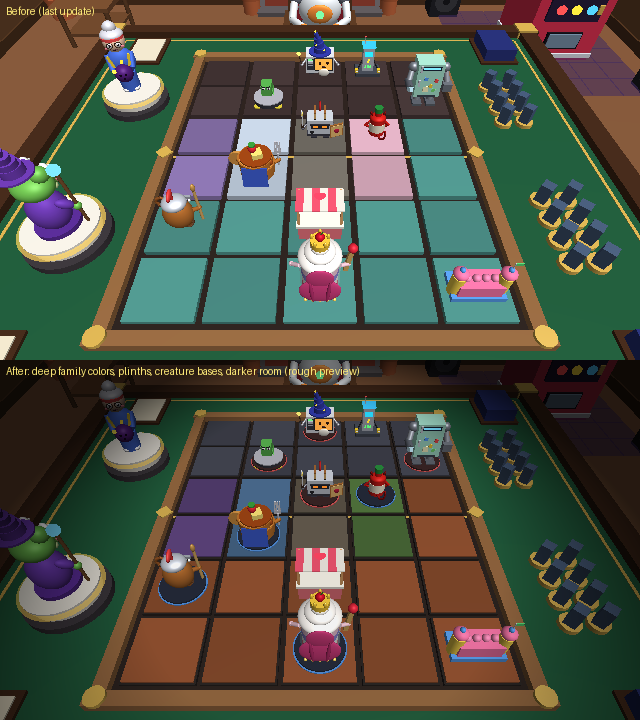

# Deck Wars

A 3D card battler for Roblox. You walk around a cozy game room, sit down at the Duel Table and fight on a board of 4 lanes (3 rows a side, plus a row of building slots behind each side) with decks you build from your own card collection, six themed practice decks (Snack, Junk, Weather, Critter, Spooky and Robo), 69 cards, combos and a bot with three difficulties.



## Play it
1. Get the newest place file: **[DeckWars.rbxlx](https://github.com/Nash0723/deck-wars/releases/latest/download/DeckWars.rbxlx)** (it is rebuilt automatically every time something is merged into `main`).
2. Install Roblox Studio, sign in and double-click `DeckWars.rbxlx` (or in Studio: File > Open from File).
3. Press **Play** (F5).

You can also build the file yourself, see "Build it" below.

## Working together
This repo is the real home of the game. Everyone works on their own branch and changes reach `main` through a pull request (PR), so nobody overwrites anybody else's work.

1. **Get the code (once):** `git clone https://github.com/Nash0723/deck-wars.git` and `cd deck-wars`. (Or, in GitHub Desktop: File > Clone repository.)
2. **Start fresh each time:** `git checkout main` and `git pull`, then make a branch for your change: `git checkout -b my-change` (a short name like `new-spooky-card`).
3. **Change things** in the files under `src/` (or the generators, see below). Don't edit the built `.rbxlx`: it is made from these files and is not kept in git.
4. **Build and try it:** `rojo build default.project.json -o DeckWars.rbxlx`, open it in Studio and press Play. If you work with a Claude, it can run the tests too (see "Tests").
5. **Save and share:** `git add -A`, `git commit -m "What I changed"`, `git push -u origin my-change`. GitHub then shows a button to **open a pull request**.
6. **Review and merge:** the other person (or their Claude) looks at the PR, GitHub builds the game and runs the tests on it, and when it's green and you both agree, press **Merge**. Then everyone does step 2 again.

Small tips: keep each PR about one thing, pull `main` often, and if two people change the same lines, GitHub will ask you to pick which version to keep (a "merge conflict"); ask your Claude to sort it out.

**Changing in Studio instead of in files:** if you change a script or the room in Studio, the files in `src/` don't change by themselves. Either copy your script change into the matching file in `src/`, or connect Studio to the files with the Rojo plugin (`rojo serve` + the Rojo plugin in Studio) so they stay in sync. Changes to the room (`Workspace > MenuRoom`) come from `gen_world.py`, so tell your Claude what you changed and it can carry it over.

## Build it
You need [Rojo](https://rojo.space) once: `cargo install rojo --locked` (needs [Rust](https://rustup.rs)), or download it from Rojo's releases page. Then, in this folder:

```
rojo build default.project.json -o DeckWars.rbxlx
```

### Generators
Some files in `src/` are made by Python scripts. Don't edit the made files by hand; change the script and run it again (needs Python 3 and `pip install -r requirements.txt`; the model and room checks also need Rojo installed with cargo, because they read Roblox's API list from it):

| Run this | It makes | From |
| --- | --- | --- |
| `python3 gen_carddata.py` | `src/shared/CardData.luau` | `cards.py` (the card list) and the rules text in `gen_carddata.py` |
| `python3 gen_models.py` | `src/shared/CreatureModelData.luau` | `models_*.py` and `modelkit.py` |
| `python3 gen_world.py` | `src/world/MenuRoom.model.json` | `gen_world.py` |
| `python3 mock_roblox/gen_world_lua.py src/world/MenuRoom.model.json mock_roblox/WorldData.luau` | the room for the simulated Studio | the room file |

`preview/*.py` render rough pictures of the table and models with a small ray tracer (no Roblox needed).

### Tests
The tests run outside Roblox with a small Luau runner in `tools/luaurun` (needs Rust):

```
cargo build --release --manifest-path tools/luaurun/Cargo.toml
tools/luaurun/target/release/luaurun tests/lane_tests.luau src/shared                    # rules: two rows per lane, Shift, overkill, Ranged, plus 1v1 and 2v2 bot games
tools/luaurun/target/release/luaurun tests/deck_tests.luau src/shared src/server src/econ # deck rules, the starter collection, saving decks
tools/luaurun/target/release/luaurun tests/packbrawl_tests.luau src/packbrawl src/shared  # Pack Brawl: odds, casting, every card's fight script, every world
tools/luaurun/target/release/luaurun tests/economy_tests.luau src/econ src/shared src/packbrawl  # saves, session locks, Gems/Coins, Shop, boosts, Robux receipts
tools/luaurun/target/release/luaurun tests/campaign_tests.luau src/shared src/server     # Campaign: every stage, decks, rules, stars, unlocks, rewards, chests, the Challenge
tools/luaurun/target/release/luaurun tests/plaza_tests.luau src/shared mock_roblox       # Plaza: booth cards, likes once a day, titles, banners, the booth ring
tools/luaurun/target/release/luaurun -D GAMES=40 bal/campaign_balance.luau src/shared    # Campaign balance: plays every stage, prints win and star rates (slow, about 20 min)
tools/luaurun/target/release/luaurun mock_roblox/econharness.luau mock_roblox            # the whole game in a simulated Studio: title, daily reward, Shop, dev panel, a full bot match, a Campaign stage, the Plaza
tools/luaurun/target/release/luaurun mock_roblox/pullharness.luau mock_roblox src/shared src/packbrawl  # Pack Brawl in a simulated Studio, about 10 s
tools/luaurun/target/release/luaurun mock_roblox/roomharness.luau mock_roblox                           # the room's props answering the mouse (hover, click, back in place)
```

`-D NAME=VALUE` sets a setting before the script runs, for example `-D SOAK_GAMES=200` for more bot games in the rules tests (put it before the script path).

GitHub runs the rules, deck, Pack Brawl, economy, Campaign and Plaza tests and the simulated Studio runs, and builds both place files for every pull request (`.github/workflows/build.yml`).

## Project layout
| Path | What it is |
| --- | --- |
| `default.project.json` | The Rojo project: where each file goes in the Roblox place, plus the Lighting settings |
| `src/shared/` | ReplicatedStorage > DeckWars: CardData, MatchEngine (all the rules), BotBrain, StarterDecks, Rng, CreatureModelData, CreatureBuilder, Settings, Juice (menu motion and UI sounds), TitleScreen, ShopCatalog (prices and rewards), ShopUI (the Shop, counters and toasts), Cosmetics (board themes, card backs, emotes), DeckRules (what a deck may hold, the starter collection), DeckBuilderUI (the Deck Shelf), RoomLife (the room's props answering the mouse), Campaign (worlds, stages, rules, rewards), CampaignUI (the world map), Plaza (booth, like and title logic), PlazaClient (the Plaza on screen) |
| `src/server/` | ServerScriptService > MatchServer, EconomyServer (saves, Shop, Robux, dev tools), PlayerDecks (your saved decks and the starter grant), CampaignData (Campaign progress on your save), PlazaServer (booths, likes, banners, leaderboards), HubRoom (turns the painting and the door into stations) |
| `src/plaza/` | ServerScriptService > PlazaBuilder: builds the Plaza at (2000, 0, 0) |
| `src/econ/` | ServerStorage > DeckWarsServer: EconomyManager, ProfileStore (session-locked saves), DevAccess (who's a developer) |
| `src/devcontrols/` | ServerStorage > DevControls: the developer panel, copied only to developers |
| `src/client/` | StarterPlayerScripts > DeckWarsClient (menus, table, animations, camera) |
| `src/world/` | Workspace > MenuRoom (made by `gen_world.py`) |
| `cards.py`, `gen_*.py`, `models_*.py`, `modelkit.py` | Generators (see above) |
| `tests/`, `bal/`, `mock_roblox/`, `tools/luaurun/` | Tests, balance check, the simulated Studio and the Luau runner |
| `pullcinematic.project.json` | The separate Pack Brawl test place (`DeckWars_PullCinematic.rbxlx`) |
| `src/packbrawl/` | ReplicatedStorage > PackBrawl: the pull cinematic (see "Pack Brawl" below) |
| `src/pullserver/` | ServerScriptService > PullServer: rolls every pull (main game and test place) |
| `src/pullclient/` | The test place's Pack Party test panel |
| `assets/sounds/` | Our own Pack Brawl sounds (made by `tools/make_sounds.py`), ready to upload |
| `docs/` | Pictures for this README |

## How to play
- **The room:** click a station or a button at the bottom (⚔ Duel Table, 📚 Deck Shelf, 🎁 Pack Party, 🛒 Shop, 🏆 Trophy Wall, ⚙ Settings), or press **A / ←** and **D / →** to go to the station before or after. **S / ↓** (or Backspace, gamepad B) goes back to the room view. Top right, **👥 Party** and **⚙** are always there, in the room and at the table.
- **Duel Table:** Bot, 1v1, 2v2 or Cup. Pick one of your own decks (built at the Deck Shelf) or a practice deck, a bot difficulty and a background world, then "Sit down and play!".
- **The board:** each side has **4 lanes**, and every lane has a **Front** spot (nearest the middle), a **Back** spot behind it and a **building slot** behind those. Your deck picks the landscape of each lane; a creature on its own landscape gets +1 attack.
- **Play a card:** drag it onto a glowing spot, or click it and then the spot. A see-through copy of the creature glides after the pointer and snaps onto the nearest spot it can go (orange means it would replace one of yours). Buildings go in a building slot and help both rows of their lane.
- **Spark and Shift:** click one of your creatures. 🌀 **Spark** uses the purple ability on its card; ↕ **Shift** (1 ✨, once a turn) swaps it to the other row of its lane (trading places with your creature there). Either way that creature skips its attack this turn.
- **BATTLE:** Front creatures hit the first enemy in their lane (Front first, then Back), or the hero if the lane is empty. Back creatures wait unless they're **Ranged** (they shoot the weakest enemy in their lane or the lanes next to it) and step up to the Front when it's free. **Overkill**: damage left over after a creature falls rolls on to the next one in the lane, then the hero.
- **Big Move:** deal enough damage and your hero's ★ Big Move is ready, once a match. You win when the other side's hit points reach 0.
- **Trophy Wall:** your level, the daily reward, today's three quests and the achievements (claim each once for Gems).

## Change the speed
| Setting | Where | Default |
| --- | --- | --- |
| Turn length | ServerScriptService > MatchServer, `TURN_SECONDS` | 90 |
| Bot's pause before its turn | MatchServer, `BOT_TURN_START_PAUSE` | 1.5 |
| Bot's pause before each action | MatchServer, `BOT_THINK_SECONDS` | play 2.0, move 1.2, attack 1.4, defend 1.0, chant 1.6 |
| Speed of all table animations | players pick Slow / Normal / Fast in Settings; the numbers are `Settings.Pace` in ReplicatedStorage > DeckWars > Settings | Normal = 1.0 (Slow 1.3, Fast 0.75) |
| Default settings for new players (volumes, action camera, shake, speed...) | ReplicatedStorage > DeckWars > Settings, `Settings.Defaults` | see the file |
| Where the camera sits on your turn and on the bot's turn | DeckWarsClient, `SeatYou` and `SeatOpp` in the `CAMS` list near the top | position, the point it looks at, and the zoom (field of view) |

## Change cards and rules
- Every card's cost, attack, health and text is in ReplicatedStorage > DeckWars > CardData. What a card actually does lives in MatchEngine.
- The combo numbers are near the top of CardData: `PowerMax` (most Power a creature can hold, 3), `SandwichBonus` (1), `SoakBonus` (1), `ZapBonus` (2), `PackMax` (most attack Pack can add, 2), `ScrapMax` (most Scrap on one tile, 3) and `ScrapGain` (+1/+1 per Scrap). `FamilyRules` and `RuleText` hold the help texts.
- Going first: `FirstTurnDraw` in CardData (false = the first player skips their first draw; set it to true to undo that) and `SecondPlayerCard` (a card id to give the second player an extra card).
- Board size and reach are at the top of the card list in CardData: `Cols` (lanes), `Rows`, `HomeRows` (your half), `SummonRows` (where creatures appear) and `HeroAttackRows` (how deep in the enemy half a creature must stand to hit the hero). Building slots are rows 0 and `Rows + 1` in MatchEngine.
- Deck rules are in ReplicatedStorage > DeckWars > DeckRules: `MaxThemes` (2), `MinCards` (20), `MaxCards` (30), `MaxCopies` (3), `MaxCopiesByRarity` (1 Legendary, 1 Secret), `StarterCards` (what new players get) and `DefaultDeckSlots`.
- Defend and the chants are in CardData too: `DefendArmor`, `DefendCounter`, `RaisedFades` and `Chants` (each family's chant: name, energy cost, amount, range and text). What each chant does is in MatchEngine (`chantWith`).
- The six decks and their blurbs are in StarterDecks.

## Change the lighting
Click **Lighting** in Studio's Explorer. `Ambient` is the overall room brightness (now 0.14, 0.11, 0.10) and `ExposureCompensation` brightens or darkens everything (now -0.2; the last update had 0.25). If the board is too dark on your screen, raise ExposureCompensation a little (try 0). Under Lighting there are **Bloom** (glow), **ColorCorrection** (color and contrast) and **DepthOfField** (soft blur far away). The two table lamps (SpotLights over the board), the fireplace and the room lamps are lights inside Workspace > MenuRoom. The terrain colors are in DeckWarsClient (`TERRAIN_LOOK`), and the creature bases are made in `spawnUnit`.

## Where things are in Studio
| Place | What it is |
| --- | --- |
| ReplicatedStorage > DeckWars > CardData | Every card's numbers and text, the combo numbers and the board size. Edit here to rebalance |
| ReplicatedStorage > DeckWars > MatchEngine | All the rules: walking, swapping, attacking, defending, chants, Power, Soak, Scrap, Sandwich, Combo, buildings, terrain and every card ability |
| ReplicatedStorage > DeckWars > BotBrain | The bot (Easy, Medium, Hard). It walks, swaps, builds, defends, chants and picks its fights |
| ReplicatedStorage > DeckWars > StarterDecks | The six themed 30-card decks |
| ReplicatedStorage > DeckWars > CreatureModelData | The built-in 3D models, as data (made by `gen_models.py`) |
| ReplicatedStorage > DeckWars > CreatureBuilder | Turns that data into Roblox models |
| ServerScriptService > MatchServer | Runs matches on the server so nobody can cheat, runs the bot and the turn timer |
| StarterPlayer > StarterPlayerScripts > DeckWarsClient | Menu room camera, menus, the match screen, the hand of cards, tile glows, clicking on the table, the command buttons, the action camera (`actionCam`), Scrap heaps (`scrapFx`) and all table animations |
| Workspace > MenuRoom | The room. Move or restyle anything, but keep the names of the parts in Stations > DuelTable > Board (`Tile_1_1` to `Tile_4_6`, the building slots `Tile_1_0` to `Tile_4_0` and `Tile_1_7` to `Tile_4_7`, `Hero_Near`, `Energy_Near_1` and so on) |
| ReplicatedStorage > CreatureModels | Empty folder for your own models (see below) |
| ReplicatedStorage > DeckWars > ShopCatalog | Every price, reward, booster and Gem bundle (paste Developer Product ids here) |
| ServerStorage > DeckWarsServer > DevAccess | Who gets the developer panel (UserIds and usernames) |
| ServerScriptService > EconomyServer | Loads and saves players, runs the Shop, Robux purchases and the dev tools |

## Use your own models
Put a Model in ReplicatedStorage > CreatureModels and name it after the card id, for example `toaster_knight` or `snack_bar` (ids are in CardData). Build it facing the front (-Z); the game shrinks it to fit a tile, stands it on its feet and puts a round base under creatures. The same works for the heroes (`hero_bonk`, `hero_granny_bolt`). Parts named `Lid` are hidden eyelids the game flashes to make a model blink.

## What was tested, and what wasn't
- **Rules:** the rules engine passes 211 automatic checks, including new ones for Power, Sandwich, Combo, Soak and Zap, Scrap and the Titan discount, Pack, Grudge, Upload and the going-first rule, plus 120 bot-vs-bot games between the Easy, Medium and Hard bots with no errors, in which every card in the six decks got played.
- **Balance (bot-vs-bot games on Hard, five rounds of 1,080 games):** the first combo version was lopsided (Critter Crew won only 31%, Sugar Rush 62% and Scrap Heap 60%), so cards were adjusted between rounds (see "Balance changes" above). In the final 1,080 games every deck won between 46% and 54%: Sugar Rush 51%, Scrap Heap 54%, Storm Front 52%, Critter Crew 49%, Haunted Mall 48% and Robo Rumble 46%. Scrap Heap against Storm Front is still the most one-sided pair (Scrap Heap wins 72%), so tell me if it feels unfair when you play it. With the old first-turn draw the first player won 61% (still 61% when the second player got a Spare Battery instead), so now they skip it; in the final games the first player won 45%.
- **Simulated Studio:** the Studio scripts ran in a simulated Roblox that checks every property, enum and method name against Roblox's API list. It played 6 full matches through the real menus, buttons and table clicks, plus an idle match ended by the turn timer, leaving mid-match and junk data from a cheating client, and replayed every animation on a real board. New checks for this update: every combo animation (Power, Soak, Zap, Scrap, Upload, Sandwich, Combo, spell cast and heal) plays without errors, Scrap heaps show on their tile, the line under a creature shows ⚡ Power and 💧 Soaked, the log calls out a Combo, creatures stand on round bases, and the dark screen edges are on during a match. All 79 checks passed with 0 errors and 0 warnings.
- It has **not** been opened in real Roblox Studio yet (that can't be done from here). The new lighting was judged with a rough preview render (`docs/table_preview.png`: the last version on top, this one below), not Roblox's own renderer, so brightness is the thing most likely to need a tweak. If the board looks too dark on your screen, raise Lighting > ExposureCompensation a little (see "Change the lighting"); if it's still too bright, lower it. If you see a red error in Studio's Output window, copy it to me.
- Realistic lighting with shadows is heavier on old phones. If it runs slowly, set Lighting > PrioritizeLightingQuality to off.
- **Settings update:** a new 12-step check in the simulated Studio walks the stations with A, D and the arrow keys (including wrapping around both ways), changes settings through the real buttons, checks they reach the server once (not on every click) and that the in-match window shows the same values, then Reset and S back to the room. The rules tests check that the server throws away bad saved settings. Saving to a DataStore can't run in the simulator, so test it in Studio: turn on Game Settings > Security > "Enable Studio Access to API Services", change a setting, stop, play again. Without that switch settings simply reset every time you play; nothing breaks.
- **Models and board fights update:** every model was checked part by part for pieces buried inside bodies, and every fight rig was dumped before and after the overhaul (the only changes are the intended ones). In the simulated Studio two new checks replay a full round of fights on a real board: the creatures' arms, legs and heads really move (up to 0.73 studs from where they were built) and afterwards every part is back in place (9 creatures checked, worst 0.000 studs off). The simulator itself had a rounding bug that slowly bent any model it moved every frame until it flew apart; that is fixed in the simulator (real Roblox keeps its rotations clean), and the check now fails if any part ever ends up at an impossible spot. All 110 checks passed with 0 errors and 0 warnings, plus 232 rules checks, 6,283 Pack Brawl checks and the pull cinematic run. The fights have **not** been watched in real Studio yet, so tell me if a move looks off.
- Known limits: one duel table, so only one player per server should play a bot at a time. Table matches have no sound yet (only Pack Brawl does). Playing friends comes later.


## Pack Brawl: the pack-opening cinematic
Every pack pull is a fight in the Brawl Box, and the card you pulled always wins. The rarer the card, the more creatures crash the fight first: Common is a 4 second 1v1, Secret is 15 seconds of chaos that cracks the screen. The full blueprint (script for every tier, camera, effects, sound, Roblox setup) is in the design doc: https://claude.ai/artifact/3kHVcDqDcoNJascS8k77S6

It is part of the main game: walk to the Pack Party corner (click the Pack Shelf, or the Pack Party button), pick a pack and press "Open 1" or "Open 10". While you test in Studio there is also one button per tier to preview that tier's cinematic (those only work in Studio or for developers, so live players can't force a Secret). During a cinematic, hold the mouse (or Space) to play it 3x faster, or press SKIP. Pulls cost Gems (see "The Pack Shelf" below).

### The Pack Shelf
The Pack Party corner has a lit display shelf with seven packs: the **Brawl Pack** (every card) on the top step, and one themed pack per family below it, each with a small figurine of that family's Legendary next to it:

| Pack | Family | Mascot |
|---|---|---|
| Sugar Rush Pack | Snack | Queen Parfait |
| Scrap Heap Pack | Junk | The Junk King |
| Storm Front Pack | Weather | Stormlord Nimbus |
| Burrow Bunch Pack | Critter | Big Momma Moose |
| Midnight Mall Pack | Spooky | The Mannequin Duke |
| Overclock Pack | Robo | Mega Blender Prime |

Hover a pack and it lifts; click it (or use the arrows, the dots, or Q / E) and it comes forward off the shelf, its riser lights up and its mascot hops. The panel shows the pack's name, what's inside and the exact chance of every card (Roblox requires showing the odds of paid random items), plus your Gems. Every pack has the same rarity odds; a themed pack only changes which card of that rarity you get: 3 in 4 cards come from its family and 1 in 4 from the shared spells and buildings. If the family has no card of the rolled rarity (most have no Secret), the card comes from every card of that rarity, so a Secret can still turn up anywhere. Prices: 1 pack = 100 Gems, 10 packs = 900 Gems (and a 10-pull always holds an Epic or better).

Opening: the chosen pack leaps off the shelf at the camera, you tap it open (the pack tease), the Pack Brawl plays, and then the best card gets its own reveal: the pack drops in, its top rips off with light pouring out, the card rises face down, flips, and slides aside for a **stat card** (rarity, family, terrain, Attack / Health / Cost bars that count up, keywords, ability text, how many you own). Tap once to jump to the finished stat card, tap again to close. A 10-pull then shows the fan of all ten cards.

The server decides everything: it takes the Gems first (refunds them if anything fails), rolls the cards, saves them to your collection and only then tells the client what to show. It uses the economy's `EconomyManager` (ServerStorage > DeckWarsServer); if that isn't in the place, a test wallet gives everyone 1000 Gems per visit and nothing is saved.

Where to tweak it: packs, names, colors, prices and the 75% family share are at the top of `src/packbrawl/Packs.luau` (keep one pack per line: `gen_world.py` reads it to color the shelf, so run `python3 gen_world.py` after changing colors). The shelf model is made by `gen_world.py` (`build_pack_shelf`, position `SHELF_AT`). Hover/selection motion: `src/packbrawl/PackShelf.luau`. The rip and stat card: `Reveal.single` and `Reveal.statCard` in `src/packbrawl/Reveal.luau`. `python3 preview/shelf.py` renders a rough picture of the corner.

The separate test place still builds, for trying the cinematic on its own:

```
rojo build pullcinematic.project.json -o DeckWars_PullCinematic.rbxlx
```

### Real fights
The creatures fight with moving parts: arms, legs, heads, tails and wings move on their own. They jab, cross, hook, uppercut and throw haymakers, swing whatever they hold (spears, wands, plungers, canes...), kick, stomp, headbutt and tail-whip. Some punches get blocked ("BLOCK!") or dodged with a duck, sway or sidestep ("MISS!"). A hit creature flinches or staggers; a knocked-out one flies off flailing and lands flat on its back. Every Epic, Mythic, Legendary and Secret creature has a named signature move (Rocket Punch, Cane Riposte, Antler Toss, Omega Rush...) for its big hits, and the winner cheers or flexes at the end.

- `Rig.luau` splits each creature model into moving parts by its part names and where they sit, and works out shoulders, hips and necks. `Rig.Overrides` fixes odd shapes by hand.
- `Moves.luau` has every move as keyframed poses, the signature moves (`Moves.Signatures`, keyed by card id), and which creature uses which move (`Moves.pickAttack`).
- `Scripts.luau` adds a `swing` cue before every hit, timed so the blow lands exactly on the hit, plus `dodge` cues.
- `luaurun -D IDS="toaster_knight,lightning_llama" preview/rig_poses.luau src/packbrawl src/shared > poses.log` then `python3 preview/brawl.py poses.log out/` draws creatures frozen mid-move, to check a rig without Studio.

Rarity tiers are now Common, Rare, Epic, Mythic, Legendary, Secret (low to high), in the main game too. The old tiers moved up one name each (Uncommon became Rare, Rare became Epic, Legendary became Mythic, Mythic became Legendary), so no card got stronger or weaker.

| File (in `src/packbrawl/`) | Job |
| --- | --- |
| `PackParty` | The Open 1 / Open 10 (and Studio-only tier preview) buttons; used by the main game's Pack Party corner and the test place |
| `Rig`, `Moves` | Moving parts and fighting moves (see "Real fights") |
| `PullRates` | Odds (Common 55%, Rare 27%, Epic 12%, Mythic 4.5%, Legendary 1.2%, Secret 0.3%) and the 10-pull Epic guarantee |
| `Casting` | Who fights: 2 Common starters, crashers by tier, the "It's Not Over" fake ending (30% on Mythic and up) |
| `Scripts` | The choreography of each tier as a list of timed cues |
| `Director` | Plays the cues on one clock; skip, fast-forward and cleanup |
| `Arena`, `Fighters`, `CamRig`, `Fx`, `Poses` | The Brawl Box, moving the creature models, the camera, effects, victory poses and ultimates |
| `Sfx`, `Reveal` | Sound and the card reveal / 10-card fan |

### Sounds
All sounds were made from scratch for this project by `tools/make_sounds.py` (no samples), so you own them. Nash uploaded them to Roblox, and their ids are in the project files (SoundService > PackBrawlSounds in `default.project.json` and `pullcinematic.project.json`), so every build has sound. Music (`brawl`, `theme`) plays through its own SoundGroup so the Music and Sound effects settings work separately.

To change a sound: upload a new file (View > Asset Manager > Bulk Import) or pick a Creator Store sound, and paste its id into the matching `SoundId` in both project files (or in Studio, SoundService > PackBrawlSounds).

### Where to tweak it
- Lengths, who crashes in and when: `Scripts.luau` (one function per tier).
- Odds: `PullRates.luau`. Fake ending chance: `Casting.FakeOutChance`.
- Colors, bloom and camera shake per tier: `Kit.luau` (`TierColor`, `TierGrade`, `TierCamera`).
- Tier preview buttons: on only in Studio. The test place forces them on with the `AllowTierPreview` attribute on ServerScriptService > PullServer.
- A move looks wrong on one creature: tweak its keyframes in `Moves.luau`, or its rig in `Rig.Overrides`.

`preview/brawl.py` renders rough frames of the cinematic from the simulated Studio (`-D SNAP=1`), to check camera framing without Roblox.

## Match backgrounds, the Trophy Road and the table at rest

**Picking a background.** The world around the Duel Table in your matches is now picked at the **Deck Shelf**: the "🌄 Match background" button over your decks fills the big panel with every world. 👁 tries one on: the world goes up around the table, the camera floats through it and a bar at the bottom lets you wear it, buy it, step to the next one (◀ ▶, A / D) or go back (Back, Esc, Backspace). The Duel Table panel no longer has a background row. Campaign stages still bring their own world.

**Unlocking them.** Backgrounds are cosmetics (`ShopCatalog.Cosmetics`, kind `"backdrop"`), saved and equipped like board themes and card backs:

| World | How you get it |
| --- | --- |
| Card Den, Surprise me | Free ("Surprise me" picks one of the worlds you own) |
| Gumdrop Plaza, Frostglass Lake | Shop, 1,500 Coins each |
| Midnight Mall | Shop, 300 Gems |
| Sunset Grasslands, Ember Caldera, Cosmic Void | Trophy Road (45, 140 and 320 trophies), can't be bought |

They also show in the Shop's Deck & Field tab.

**The Trophy Road** (top of the Trophy Wall): every match that went the distance earns trophies, and they never go down. A win against a bot earns 4 / 6 / 9 (Easy / Medium / Hard), a win against people 10, a Cup win 25 more, a loss or draw 1. The road has 12 stops with Coins, Gems and the three backgrounds; tap a stop you've reached to claim it. Numbers live in `Progression.Trophies` and `Progression.TrophyRoad`; the server keeps the count in the save (`progress.trophies`, `progress.road`) and shows it as the `Trophies` and `RoadClaimed` attributes. The match result screen shows the trophies a match earned.

**Livelier worlds.** Every world now has moving parts (`LIFE` in `Backdrops.luau`, run by `Backdrops.update`): a candy Ferris wheel, gumdrop balloons and a shimmering rainbow; a windmill and butterflies at sunset; floating ice shards, a rippling aurora and a glowing snow-fox spirit; lava bombs from the volcanoes, breathing lava and flickering torches; a circling moon, a space station and shooting stars; flickering lamps, a runaway cart, ghost wisps and a buzzing MALL sign.

**The table at rest** (`IdleTable.luau`). Between matches the table used to show the old 5x6 tile board. It now shows the lane board at rest, exactly where the match board rises: 4 lanes a side with inlaid Front and Back rings and a building slab, brass caps, a gold seam with a Deck Wars medallion, all in your board theme's colours. Two of the game's big creatures face off in the middle lanes and swap every half minute; the rings breathe and a soft light runs along the seam. The old tile parts are hidden (each keeps its look in the `IdleTransparency` attribute, and the pull stage's copy of the table puts them back).

**Fix: the Pack Shelf glowing in other worlds.** The shelf re-lit its pack lights every frame, so they showed through a match background. The shelf now pauses while a background hides the room (`PackShelf.suspend`).

**Tested** in the simulated Studio (`econharness`): the resting board and its showcase, the picker's 8 worlds, a preview with moving parts and a dark Pack Shelf (this check fails without the fix), stepping worlds, buying and wearing one from the preview, the match played in it, trophies from the match, claiming Trophy Road stops (once each, not before you reach them) and a background unlocked from the road. Economy tests cover buying, wearing and the road-only rule. Not checked in real Studio yet.

## The Campaign and the Plaza
Two new ways out of the room, built like the hubs of tower-defense and gacha games on Roblox (a world map of stages with stars, and a shared lobby where everyone shows off), with Deck Wars' own worlds, opponents and rewards.

### The Campaign (the painting over the fireplace)
Click the painting (or the 🗺 Campaign button) to open the world map. **7 worlds × 6 acts**, each played on the Duel Table inside that world, against named opponents and a boss with its own Legendary:

| World | Opponents play | Boss | Boss rule |
| --- | --- | --- | --- |
| 🏠 Card Den | a different family each act | Bot Bonkers | none (the tutorial world) |
| 🍬 Gumdrop Plaza | Snack | Queen Parfait | Tough (+10 hit points) |
| 🌄 Sunset Grasslands | Critter | Big Momma Moose | Head Start (+2 cards) |
| ❄️ Frostglass Lake | Weather | Stormlord Nimbus | Thick Skin (+5 hit points) |
| 🌋 Ember Caldera | Junk | The Junk King | Thick Skin |
| 🌌 Cosmic Void | Robo | Mega Blender Prime | Surge (+1 magic a turn) and Tough |
| 🌙 Midnight Mall | Spooky | The Mannequin Duke | Head Start, Tough and Home Turf |

- **You play with your own decks** (built at the Deck Shelf; everyone starts with the Starter Deck). The opponents' decks grow through each world: starter-strength in acts 1-2, normal in 3-4, full in 5, and the boss plays its Legendary twice. The Card Den stays starter-strength until its boss, so the Starter Deck can clear it.
- **Stars:** ★ win, ★ win with half your hit points left, ★ win within the act's turn limit. Stars from Normal and Hard both count (252 in all).
- **Unlocks:** beat act N to open act N+1; beat a world's boss to open the next world and that world's **Hard mode** (harder bots, more rules, every boss gets Big Start).
- **Rewards:** a first clear pays 💎 30 / 35 / 45 / 55 / 70 / 100 (act 1 to 6, ×1.5 on Hard) and a card of the world's family (Common up to Mythic; a Hard boss gives its Legendary). Replays can drop family cards (up to 10 drops a day), and a Normal boss replay has a 2% chance at its Legendary. **Star chests** in each world at 6★ (💎 50), 12★ (💎 100 + an Epic) and 18★ (💎 150 + a title for your nameplate).
- **The hourly Challenge** opens after the Card Den's boss: one stage for everyone, a new one every hour (a full-strength family deck with two random rules). Winning pays 💎 60 and a random Rare, Epic or Mythic card, once an hour.
- After a stage: the stars pop in, the rewards and new cards show, and **Next ▶ / ⟳ Again / Map** take you on.

### The Plaza (the front door)
Click the front door (or 🏙 Plaza) and walk out. In the Plaza you walk around as your Roblox avatar with everyone else in the server.

- **Booths:** everyone in the server gets one of 12 booths around the square. It shows your 3 best cards (your rarest, or the ones you pick with **🖼 My booth**), your name, title and likes.
- **Likes:** walk up to a booth's heart and press E. One like per booth per day, never your own. The Most Liked board counts them.
- **Companions and nameplates:** the first creature on your booth walks along with you, and a nameplate shows your title, level, Campaign stars and likes. Titles come from star chests and from your rarest pull ever (Rare: Lucky Charm, up to Secret: Keeper of Secrets).
- **The Pull Altar** in the middle opens packs right there (the same Pack Party as the room, without the dive into the table).
- **Big pulls:** a Mythic or better pull gets a banner for the whole server (15 s later, so it doesn't spoil the puller's own reveal), a pillar of light over the altar and a line on the **Hall of Pulls**. A Secret is told to every server.
- **Leaderboards:** Campaign Stars, Highest Level and Most Liked Booths (saved in OrderedDataStores every 2 minutes; in Studio without API access they show the players in the server).
- **Gates:** 🏠 Home (back to the room), 🗺 Campaign (opens the map) and the ⚔ Duel Table kiosk.

### Where to change things
- Every Campaign number is in `ReplicatedStorage > DeckWars > Campaign` (worlds, opponents, rules, decks, turn limits, rewards, drops, chests, the Challenge). The save part is `ServerScriptService > CampaignData`; the map screen is `CampaignUI`.
- The Plaza's numbers (booths, banner rarities, likes, titles) are in `DeckWars > Plaza`. The place is built by `ServerScriptService > PlazaBuilder` at (2000, 0, 0) when the server starts. **To build your own Plaza in Studio,** make a `Workspace > Plaza` model with the part names listed at the top of PlazaBuilder and it is used instead. `PlazaServer` runs booths, likes, banners and boards; `PlazaClient` is the screen.
- `ServerScriptService > HubRoom` turns the painting and the door into the two new stations when the server starts.

### Balance
`luaurun -D GAMES=40 bal/campaign_balance.luau src/shared` plays every stage many times with a bot standing in for you (the Starter Deck on the Card Den, a themed deck later, a Hard brain on Hard mode) and prints the win rate, how often each star is earned and how long wins take. Results with 40-60 games a stage (the stand-in plays worse than a person, so real players should do better):

| | Normal | Hard |
| --- | --- | --- |
| Card Den acts 1-5 | 65-95% wins | 35-72% |
| Other worlds, acts 1-2 | 78-100% | 22-68% |
| Other worlds, acts 3-5 | 28-80% | 32-78% |
| Bosses | 28-42% | 22-45% (Den 73%) |

The ♥ star (half your hit points) is earned in 30-100% of wins (hardest in Frostglass Lake) and the ⏱ star in 33-100%, so three stars takes a good game. Tuning from the first run: the Card Den's later acts were too hard for the Starter Deck (10% at act 5, now 65%), turn limits were too loose (the ⏱ star came free), and two boss rules were swapped for Thick Skin (Junk King with Surge won 10%, Stormlord Nimbus with Home Turf 18%). The hardest stages left are Hard-mode act 2 in the Cosmic Void (22%) and the Hard bosses of the Cosmic Void and the Midnight Mall (22%); tell me if they feel unfair.

### Tested
`tests/campaign_tests.luau` (every stage builds and plays on the real engine, decks, rules, stars, unlocks, rewards, drop cap, chests, the Challenge) and `tests/plaza_tests.luau` (booth cards, picks, likes, titles, banners, the booth ring) pass. The whole-game run in the simulated Studio (`econharness`) now also opens the map, plays act 1 of the Card Den with your own deck through the real client, checks the stars, Gems, card and act 2 opening, then walks out into the Plaza: booth cards, the booth editor, a friend's like (and a second one refused), a Mythic banner and the Hall of Pulls, the boards, the altar's pack panel, and the Duel kiosk back inside with the room's light and camera restored. **Not checked in real Studio yet**: walking with Roblox's own camera, the ProximityPrompts, OrderedDataStores and MessagingService only run for real there.

## The room answers your mouse
Point at things in the room and they react. Click them (or tap them on a phone) and they do something bigger. Every now and then one of them fidgets on its own, and Pickles blinks. The mouse turns into a pointing hand over anything that reacts. The idea comes from the clickable props in the corners of digital card game boards and from cozy room games, where poking the scenery is half the fun. Everything happens on your own screen only. The moment you sit down at the table, every prop snaps back to where it was.

| Where | Point at it | Click it |
| --- | --- | --- |
| Deck Shelf | a binder slides half out and tips toward you, and its neighbours wobble; card boxes lift and turn; the reading lamp brightens and nods | the binder pops out and back; a box hops and spins; the lamp flickers |
| Pack Party | balloons rise and sway on their strings; speakers thump with the beat; the disco ball spins faster; the dance floor lights up under the cursor, with a ring running out from each tile you cross; the lid of a mini-pack jar lifts | a balloon bounces; a speaker kicks and sends a ring across the dance floor; the disco ball whirls; a jar's lid pops up |
| Shop | Pickles waves (and his eyes follow your cursor all the time); the register's drawer slides out and its digits flicker; candy jars wobble; boxes on the back shelf tip forward; packs on the counter lift; touching the awning sends a wave along its stripes | Pickles jumps and spins; the drawer shoots out with a ding and the keys press; a jar hops and its candy rattles; a pack on the counter flips |
| Trophy Wall | a trophy lifts, turns and shines; pennants flutter; certificates hang a little crooked | the trophy jumps, spins and sparkles; a certificate swings |
| Settings radio | the radio bops to its own beat, the needle sweeps, the knobs turn, the antenna wobbles and the music notes float | the radio hops and tunes across the dial |
| The room | the fire flares; candle flames grow; the clock's hands swing round to the time on your computer; the little trophy on the mantel turns; pendant lamps sway; plants rustle; curtains sway; stars in the windows twinkle; posters lift off the wall | the fire roars; a candle puffs out and lights again; the clock hops and chimes; a lamp swings; a plant shakes; a shooting star crosses the window |

The door and the painting over the fireplace are left alone on purpose: they become the way out to the Plaza and the Campaign map.

**Change it:** everything is in `ReplicatedStorage > DeckWars > RoomLife`. Each kind of prop has one block (`def("binder", {...})`) with the part names it uses, how far it moves on hover (`move`) and its sounds (`hoverSound`, `clickSound`: a name from TableSounds, a volume and a pitch). Props are found by part name and grouped by distance, so you can move things around in Studio and they keep working. A new prop needs a new block. `RoomLife.idleFidgets = false` turns off the fidgeting on its own. Sounds follow the Settings sound effects volume.

**Tested:** `luaurun mock_roblox/roomharness.luau mock_roblox` points at and clicks every kind of prop in the simulated Studio. It checks that each one moves the right way (toward the room, never into the wall), never flies off, and goes back exactly where it was, including after a long sweep across the whole room. The whole-game run (`econharness`) also points at a binder and clicks a trophy through the real client, then checks that every prop is back in place at the table. Not checked in real Studio yet.

## The merged game (Nash's build + jaault's build)
One place, one save. From jaault's build: the hub room look, the match backgrounds and props, the fonts, levels and XP, quests on the Trophy Wall, the Party and ⚙ buttons top right, the Duel Table modes (Bot, 1v1, 2v2, Cup) and the lane board, now with **two rows per lane** (Front and Back) plus a building slot. From Nash's build: the title screen, the station icons, the developer panel with free rolls (DNash2307 and donatjalt), the deck builder and its rules, the Pack Shelf with the Pack Brawl openings (now played inside the pack's own world), the Shop (packs for Gems, items for Coins), the settings and the hover placement preview. New: achievements on the Trophy Wall, Shift, overkill, Ranged from the Back row, and a bolder outlined cartoon look for buttons and panels.

- **One save:** levels, XP, quests and achievements live on the same profile as Gems, Coins, cards and decks (EconomyManager / ProfileStore). The daily reward pays Gems and Coins and waits for you to claim it from the pop-up.
- **Match rewards:** wins pay Coins (with the anti-farming limits) plus Gems and XP: bots +20 / +35 / +50, friends +40, a Cup +150 (runner-up +50). A match too short to pay Coins pays no Gems or XP either.
- **Not checked in real Studio yet.** Everything ran in the simulated Studio (title, daily reward, Shop, dev free roll and a full bot match on the two-row board), but look at it in Studio before publishing.

## Earlier update (Nash's build before the merge): a 4-lane board with building rows, and decks you build yourself
(The tile board below was replaced by the two-row lane board in the merge; the deck builder and its rules are kept.)

### The new board
- Each side has **4 lanes** (columns) and **3 rows**: Frontline (next to the middle), Midline and Backline. Behind each side is a row of **4 building slots**. From your chair, top to bottom: their building slots, their Backline, Midline, Frontline, then your Frontline, Midline, Backline and your building slots.
- Creatures are summoned on your Backline or Midline. A creature anywhere in the enemy half can hit their hero, and creatures can hit enemy buildings in reach. Buildings don't hit back.
- **Lanes have terrain.** Your deck picks the terrain of each of your 4 lanes (from its themes). Creatures standing on their own family's terrain get +1 attack, so where you put things matters.
- **Placing feels smooth:** while you aim a creature or building, a see-through copy of it follows your mouse over the table and glides onto the nearest gold tile, and when you play it the creature steps down onto the terrain. The tiles sit flush with thin seams, and only the tiles you can use glow.
- **Buildings** go in the slots behind your rows, cost more, and work from there every turn. Lane buildings help or hit along their lane (on both halves), row buildings help one of your rows. A soft line in the building's color outlines the tiles it reaches, and hovering a slot or tile tells you what reaches it. Building on top of your own building replaces it (the old one leaves Scrap in front of the slot).

| Building | Cost | What it does |
| --- | --- | --- |
| Spiked Fence | 2 | Start of your turn: 1 damage to the nearest enemy creature in its lane |
| Bouncy Castle | 2 | Your Frontline creatures have Sturdy (a row building) |
| Snack Bar | 2 | Start of your turn: heal your creatures in its lane 2 (Snacks get Power from it) |
| Charging Station | 2 | Your creatures in its lane have +1 attack (Robos +2) |
| Bunny Burrow | 3 | You can summon anywhere in its lane on your half; a Pigeon hops in when it's built |
| Wind Turbine | 3 | Your creatures in its lane have Fast; Soaks the nearest enemy in its lane |
| Lemonade Stand | 3 | +1 energy each turn (doesn't stack, works from any slot) |
| Spooky Crypt | 3 | Your creatures in its lane have Haunt |
| Disco Cactus | 3 | Roll: your Midline creatures get +1 attack, or heal 2 (a row building) |
| Scrap Catapult | 4 | 2 damage to the nearest enemy in its lane (a random enemy if the lane is clear) |
| Haunted Arcade | 5 | A 1/1 Ghost with Haunt appears in its lane on your half |
| Rocket Lunchbox | 6 | A rocket flies up its lane: 3 damage to the first enemy creature, the rest hits the hero |

### Your collection and your own decks
- **New players** get a starter collection the first time they join: the 4 starter characters, Jelly Bean Scout and Pretzel Guard (Snack) and Pocket Mouse and Moth Mailman (Critter), 3 copies each, plus 8 simple neutral cards (2 Spare Battery, 2 Snack Break, 2 Wrong Turn, 2 Spiked Fence). That makes the 20-card **Starter Deck**, ready in deck slot 1. Everything else comes from packs and the Shop.
- **The Deck Shelf** shows your collection (cards you haven't found are dark) and your deck slots (3 to start; more in the Shop). **+ New** or **Edit** opens the deck builder: name the deck, pick a hero, pick up to 2 themes and the terrain of each lane, then tap cards in your collection to add them and tap them in the list to take them out. **Fill up** adds cards you own until the deck has 20. The builder says what is still wrong ("Add 3 more cards", "You don't own enough of...") and shows ✔ Ready to play when the deck is legal. Unfinished decks can be saved, but only ready ones can be played.
- **Deck rules:** 20 to 30 cards, cards from up to 2 themes plus any neutral cards, up to 3 copies of a card and 1 of each Legendary and Secret, and only cards you own. The server checks all of it again when you sit down, so a hacked client can't play cards it doesn't have.
- **The Duel Table** lists your decks first, then the six practice decks. The bot picks a practice deck of another theme.
- Decks are saved in the same profile as your Gems, Coins and cards (one save, so nothing can fight over it).

### 2 themes or 4? Why 2
There are 6 themes. With 2 per deck, every deck leans on its families' own rules (Sweet Tooth, Scrap, Soak, Pack, Grudge and Upload), there are 15 different pairs to discover, and the cards of each theme can be balanced against a small set of partners. With 4, a deck could take the best cards of two thirds of the whole game, the family rules would barely matter (you would rarely have enough of one family on the board for Pack, Grudge, Upload or a Combo), most strong decks would end up looking the same, and every new card would have to be balanced against far more combinations. So decks use at most 2 themes. It's one number if you want to try 4: `MaxThemes` in ReplicatedStorage > DeckWars > DeckRules.

## Earlier update: Gems, Coins, the Shop and a developer panel

### Two currencies
- **💎 Gems** are the premium currency and open card packs at the Pack Party. You get them from Robux Gem bundles, the daily login, your first win of the day, level ups and a small daily Coin exchange.
- **🪙 Coins** are earned by playing and spent in the Shop: single cards, deck slots, board themes, card backs, emotes and boosters.
- New players start with 💎 300 and 🪙 500. The counters sit at the top right of the room; the pack shelf and other scripts can read them from the Player attributes `Gems` and `Coins`.
- Every number (prices, rewards, starting money, odds boosts) is in `src/shared/ShopCatalog.luau`. Only the server's copy counts, so a hacked client can't change a price.

### Earning
| How | Coins | Gems | XP |
| --- | --- | --- | --- |
| Daily login (once per UTC day) | 150, +25 per streak day (up to 300 on day 7) | 15 (+60 on day 7 of a streak) | |
| Bot match win (Easy / Medium / Hard) | 60 / 100 / 160 | first win of the day: 30 | 40 / 60 / 90 |
| Bot match loss or draw | 20 / 30 / 45 | | 15 / 25 / 35 |
| Level up (100 XP for level 2, +25 more per level) | 100 | 40 | |

A match only pays if it lasted a minute and you took 3 turns, nothing for leaving, and 30 paid matches per day (so nobody farms the bot all night). The reward pops up once you've seen the last blow.

### The Shop (Pickles' counter)
Walk to the Shop counter and the Shop window opens with three tabs:
1. **🃏 Daily Cards:** six cards for Coins (2 Common 120, 2 Rare 350, 1 Epic 900, 1 Mythic 2,400). Everyone sees the same six, they change at UTC midnight, each can be bought once a day, and the tile tells you how many you own. Legendary and Secret only come from packs.
2. **🎨 Deck & Field:** board themes that repaint the duel table (Midnight Velvet, Royal Emerald, Ember Forge, Frost Glass for Coins, Starlight for Gems), card backs for every face-down card (Crimson Crest, Jade Lattice, Gold Foil, Void Spiral), emotes for the new 💬 button in matches (Bot Bonkers sometimes answers), and deck slots (3 to start, up to 10, 600 Coins each).
3. **💎 Exchange & Boosts:** Robux Gem bundles, Coins → Gems (500 → 25, 3 times a day) and Gems → Coins (50 → 600), Lucky Charm / Lucky Horseshoe (the next 3 or 10 pack openings have 1.5x the chance of Epic and better; a 10-pack counts as one) and XP Snack / XP Feast (double match XP for 30 minutes or 2 hours).

Anything that costs Gems needs a second tap ("Tap again"), so nobody spends Gems by accident.

**To sell Gem bundles for Robux:** publish the game, then in the Creator Dashboard open the experience > Monetization > Developer Products, create one product per bundle (names and prices are in `ShopCatalog.GemBundles`), and paste each product id into `productId`. Until then the bundles show "Not on sale yet". Purchases are granted exactly once per receipt and only confirmed to Roblox after the new Gems are saved. Players in countries where paid random items are restricted don't get the Robux bundles (Gems open random packs) but can still earn Gems.

### Saving
One save per player in the DataStore `DeckWarsPlayer_v1`: Gems, Coins, XP and level, the card collection, deck slots, saved decks (for the deck builder), cosmetics, boosters, the daily shop and streak, and stats. It is **session-locked** like ProfileService (a small version of the same idea, written for this game, in `src/econ/ProfileStore.luau`): a server only writes a save it holds the lock on, a new server waits for the old one to let go, and a lock from a crashed server can be taken over after 4 minutes. That stops the classic bug where a player hops servers and their Gems get lost or doubled. It autosaves every minute, saves when you leave and when the server shuts down. If the save can't load, the player is asked to rejoin instead of playing on an empty save.

In Studio saving needs Game Settings > Security > "Enable Studio Access to API Services". Without it the game still runs with a temporary save and shows a notice.

### Developer panel (free rolls)
Developers get a **DEV** tab on the left of the screen (F7 toggles it): free rolls of any rarity from Common to Secret, free 1 and 10 pulls at the real odds, +1,000 Gems, +10,000 Coins, 10 lucky pulls, "New shop day" and "Reset my save". The normal Pack Party buttons stay as they are, so true odds can still be tested.

- Who's a developer: the usernames **DNash2307** and **donatjalt** (looked up to their UserIds when the server starts) and the experience owner. Paste the numeric UserIds into `DevAccess.UserIds` in `src/econ/DevAccess.luau` when you have them (roblox.com/users/**<UserId>**/profile); that skips the lookup.
- The panel lives in ServerStorage, which players can't see, and the server only copies it to developers. Every dev button is checked against the UserId on the server again, so a hacked client firing the dev remote gets nothing (the server logs it).
- Free rolls use the pack pull server: it honours `free` and a forced rarity only for developers (see the pack shelf update).

### For other scripts
`ServerStorage.DeckWarsServer.EconomyManager` (find it with `ServerStorage:FindFirstChild("EconomyManager", true)`):

| Call | What it does |
| --- | --- |
| `getBalance(player, "Gems" or "Coins")` | the balance (waits for the save to load) |
| `trySpend(player, currency, amount, reason)` | pays if the player has enough; true when paid. Whole numbers only |
| `grant(player, currency, amount, reason)` | gives currency (refunds, rewards) |
| `grantCards(player, { cardId, ... })` | adds cards to the saved collection; returns isNew, counts, uniqueOwned |
| `getCollection(player)`, `ownsCard(player, id)`, `getDeckSlots(player)` | read the collection and deck slots |
| `takePullLuck(player)` | once per paid pack opening: the luck multiplier (1 = none) for `PullRates.luckyOdds` |
| `waitForData(player)` then `markDirty(player)` | the live save table (`data.decks`, `data.flags`) for the deck builder |
| `matchReward(player, { result, difficulty, seconds, turns })` | pays a finished match (MatchServer calls it) |

`ServerStorage.DeckWarsServer.DevAccess.isDev(player)` tells whether a player is a developer.

## Earlier update: a catchier opening, a livelier menu and a pack you tap open

### The opening
Joining the game now shows a title screen over the card room while the camera drifts slowly across it. The screen fades in from black, DECK and WARS slide in from both sides and slam together (flash, shake, gold sparks), a light glint runs over the gold logo every few seconds, two random showcase creatures (Epic and up) turn on pools of light at the sides, and embers drift up. The gold PLAY button pulses; PLAY (or Enter, Space, gamepad A) sweeps the title away, the cinema bars slide off, and the camera flies from low over the table up to the room overview while the menu pops in piece by piece. Code: `src/shared/TitleScreen.luau`; camera spots `TitleFrom`, `TitleTo` and `Entrance` in the `CAMS` table at the top of DeckWarsClient.

### A livelier menu
- Every button grows a little under the mouse, squishes when pressed and springs back with a click sound.
- The station buttons are darker with gold icons, and the station you are at gets a gold underline and a little bounce.
- Station panels slide in from the right and their contents fade up one after another; hovering a station in the room gives it a soft pulsing glow.
- The menu title uses the same gold logo look as the title screen.

### Opening a pack
Before the Pack Brawl, the pack rises into your hands. Tap it (or press Space) three times: each tap jolts it, cracks it, and light leaks out of the cracks. The light's color teases the pull ("EPIC OR BETTER"). It never promises more than you really got, and for Mythic and up it stops one tier short so the brawl can still surprise you. After the last tap the pack shakes and flies off into the ring, where the brawl picks it up. An untouched pack opens by itself after 5 seconds, and "Pack fights: Quick" needs only one tap. Code: `src/packbrawl/PackTease.luau` (`Taps`, `QuickTaps`, `AutoOpen`, and `capFor` for the tease rule).

After the brawl the rarity name slams in above the card with sparks in its color (a flash for Epic and up, a confetti shower for Legendary and Secret), and the card hovers while you look at it. In a 10-pull the cards are dealt in one by one, and face-down Epic-and-up cards glow in their rarity color before you flip them.

### The motion toolkit
`src/shared/Juice.luau` holds the helpers all of this uses: `button` (bouncy buttons), `pop`, `popIn`, `popOut`, `wobble`, `breathe`, `bob`, `shine`, `confetti`, `stars`, `flash`, `shake`, `sunburst` and `sound`. Sounds reuse the Pack Brawl sounds already uploaded (pop, whoosh, thud, glass, charge, heavy, theme), so nothing new needs uploading, and they follow the Sound effects and Music volume settings. The board and the match rules are unchanged.

## Earlier update: detailed models and real fights on the table

### Every model rebuilt with more detail
All 61 built-in models (creatures, buildings, heroes and the bot) were rebuilt from scratch with far more parts (about 7,700 in all), keeping each one's idea, colors and family style: stitched seams, rivets, laces, labels, badges, belts, patterned capes, painted faces with lids, teeth and cheeks. Their backs got the same care, since from your seat you mostly see your own creatures from behind (the mall cop's SECURITY jacket, the vending machine's vents, the hot sauce's barcode). A second pass moved details that were hidden inside bodies (sash badges, the pretzel twist, shoe laces, stripes, flowers, arcade buttons, the crypt door) onto the surfaces where you can see them.

- The models are made by `gen_models.py` from the `models_*.py` files (helpers in `modelkit.py`), into `src/shared/CreatureModelData.luau`.
- `python3 preview/sheet.py models_snack --only=jelly_bean_scout --size=500` draws a rough preview (add `--back` to see the back).

### Punches and kicks on the table
Creatures on the table now fight with their arms and legs, using the same moving parts and moves as Pack Brawl, instead of bumping into each other as one solid block:

- Before an attack both creatures raise their guard. The attacker lunges in and throws a jab, cross, hook, uppercut, kick, haymaker or spin kick (bigger hits get bigger moves), swings what it holds, or headbutts, bumps, charges and tail-whips if it has no arms. The target flinches or staggers, or blocks when it is guarding.
- When the target hits back, it takes the blow on its guard and punches straight back, and the attacker flinches.
- Ranged creatures make a throwing motion as their shot leaves. Big creatures with long fronts (the moose) barely step forward, so the two bodies don't sink into each other.
- **The twitch when two creatures clashed is fixed.** A creature used to jump to the first frame of each animation (out of its breathing, a glance aside or its crouched guard) and jump back into breathing afterwards. Now every animation eases in from wherever the creature is and eases back into breathing.
- Your own models from ReplicatedStorage > CreatureModels keep moving as one piece (the game can't tell their arms from their legs).
- In code: the `limbs` section of DeckWarsClient (`limbs.bind`, `limbs.guard`, `limbs.play`, `limbs.update`), and `attackAnimation`.

## Combos and a calmer, heavier table

### Cards that build up together
You can still play simply: walk, attack, defend. But a player who plans can now grow a much stronger board. The ideas come from other games: Star Realms (cards of the same faction help each other), Slay the Spire (stacking buffs), Go and old Viking board games (surrounding an enemy), Into the Breach (pushing enemies into position) and auto-battlers like Teamfight Tactics (families that are stronger together).

- **Power ⚡.** Counters that stay on a creature: +1 attack each, up to 3. Several cards and rules give it out. A creature's Power shows under its stats.
- **Sandwich.** Attack an enemy that has one of your creatures right behind it (on the far side, in line with the attacker): +1 damage. While you aim, hovering the target says "Sandwich!" when it works.
- **Combo.** Cards with "Combo:" on them get a bonus if you already played another card of the same family this turn. Example: Moth Mailman draws 1 card, or 2 with Combo. When a card in your hand is ready to combo, it gets a gold **COMBO** tag and a gold glow.
- **Every family has its own way to grow:**

| Family | Rule | How to use it |
| --- | --- | --- |
| Snack | **Sweet Tooth**: every heal gives a Snack 1 Power, even at full health | Heal all the time: Snack Time, Pancake Paladin, Pretzel Guard's Combo and the Picnic chant. Hot Sauce Imp gets 2 Power from every heal |
| Junk | **Scrap**: Junk creatures and buildings leave Scrap on their tile when they pop. A Junk creature that steps on Scrap picks it up: +1/+1 for each | Tin Can Tom leaves 2 Scrap. Rusty Shopping Cart also picks up Scrap next to where it stops. Scrapheap Titan costs 1 less for each Scrap on the board (up to 3 less), so you choose: grow now, or save the Scrap for a cheap Titan |
| Weather | **Soak** 💧: a Soaked creature takes 1 more damage from the next hit, then dries off | Soak first (Drizzle Sprite, Grumpy Cloud, Tornado Twins, the new Water Balloon spell, the Gust chant), then hit. Zap creatures (Lightning Llama, Bolt Bug, Microwave Mage) deal 2 more on top |
| Critter | **Pack**: every Critter gets +1 attack for each friendly Critter next to it (up to +2) | Keep them together. Sergeant Snail gives the Critters next to it Sturdy |
| Spooky | **Grudge**: Grudge creatures get 1 Power whenever another of your creatures pops | Skeleton Mascot and The Mannequin Duke grow as your side takes losses, and Haunt still leaves Ghosts |
| Robo | **Upload**: when a Robo pops, its Power jumps to the Robo next to it with the least Power | Charge now gives Power at the start of your turns, and the Power Up chant gives Power |

- **26 cards were rewritten** to use these rules, and there's a new spell: **Water Balloon** (1 energy: Soak an enemy creature and push it 1 tile back). It replaced Wrong Turn in Storm Front and Coin Flip Fury in Robo Rumble.
- **Chant changes:** Picnic now costs 2 energy and gives Snacks Power even when nobody is hurt. Gust also Soaks what it blows. Power Up gives 1 Power (max 3).
- **Balance changes** after 5,400 bot-vs-bot games: Drizzle Sprite is now 1/2, Grumpy Cloud 2/3 and Roomba Rex 2/3. Scrap Heap plays one Scrap Catapult and one Pothole fewer (a second Snack Break and a Wrong Turn instead), and Robo Rumble swapped Earthquake Dance, which hurt its own small robots, for Sneeze Storm.
- **Going first:** with the combos the first player won 61% of bot games, so now the first player skips the draw on their very first turn (they still start with 4 cards and the second player with 5). In the final bot games the first player won 45%, much closer to even.
- The deck picker's blurbs now say how each deck builds up.
- **The bot plays with all of it.** It tries out its moves before it makes them, so it sees Combos, Sandwiches, Soak and Scrap.

### A darker, heavier table
- **Lighting:** the room is much darker (less ambient light, lower exposure, less glow, more contrast). The lamps over the table make a warm pool of light on the board while the rest of the room falls into shadow, and shadows are crisper.
- **Tiles feel like stone slabs:** every tile sits on a dark plinth, so it has a thick, stepped edge.
- **Terrain colors are deep and match each family's card color,** so you can see at a glance where your creatures get +1 attack: Soda Swamp is amber (Snack), Glitter Junkyard is rusty metal (Junk), Static Snowfield is deep ice blue (Weather), Pillow Peaks is soft moss green felt (Critter), Mushroom Mall is dusky purple tile (Spooky) and Lava Laundromat is grey steel plate (Robo).
- **Every creature stands on a heavy round base,** like a painted miniature: dark stone with a thin ring in its side's color (blue for yours, red for the opponent's).
- During a match the edges of the screen are softly darkened, so your eye goes to the board.

### Less going on at once, more punch when it counts
- **A quiet board:** creatures breathe slowly, glance around now and then and no longer hop. Hand cards rest still. Glows barely pulse. There are fewer particles everywhere, the purple screen flash on spells is gone, and the Big Move and Total Chaos flashes are much softer.
- **Under each creature's stats, only what's going on right now:** ⚡ Power, 💧 Soaked, 🔋 Charge left, Bubble, zZ (just arrived) and 🛡 (guarding). Its keywords are on its card: hover the creature to see it. Hovering a creature or tile also explains its Power, Soak and Scrap.
- **Hits land harder:** the target flashes white, a ring of light spreads at its feet, and everything holds for a split second (hit-stop) before the knock-back.
- **Spells:** light gathers into a glowing orb over the caster's side of the table, then bursts.
- **Heals:** a soft column of green light rises through the creature.
- **The new rules have their own small moments:** a gold glint and "+1 ⚡" for Power, a splash of water for Soak, Scrap clattering onto a tile and flying into the Junk creature that picks it up, "Sandwich! +1" over the helper, and "Combo!" when a combo goes off.

