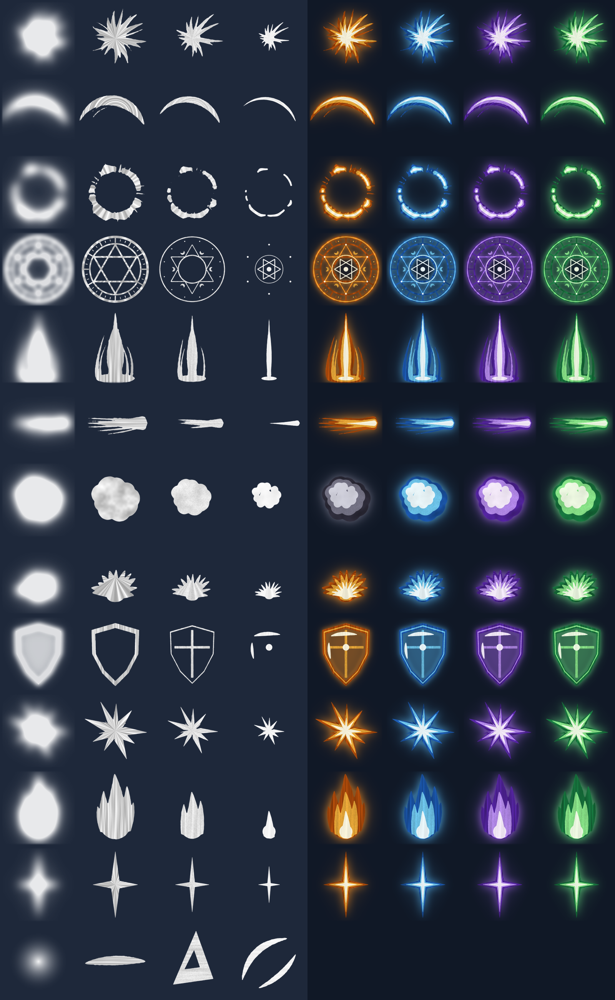

# Layered effects (LayerFx)

Every effect in the game is a picture drawn as **four layers** that sit on top of each other:

| Layer | What it is | Colour in game |
| --- | --- | --- |
| glow | a soft bloom behind everything | the family colour, half see-through |
| rim | the whole silhouette | dark and saturated |
| middle | a smaller shape inside it | bright |
| core | the hottest, smallest part | nearly white |

The layers never move as one picture: the core snaps out first and dies first, the middle follows,
the rim arrives last and lingers, the glow swells behind them, and loose bits of paint fly off on
top. That offset is what makes a still drawing feel like a hit.



## Files
- `draw_layers.py` draws the 13 sheets into `sheets/` (1024x1024, the four layers in the four
  quarters: glow top-left, rim top-right, middle bottom-left, core bottom-right). They are white
  with brush streaks, so the game tints them and one drawing works for every card family.
  `python3 vfx/draw_layers.py` (needs `numpy` and `pillow`), or `python3 vfx/draw_layers.py slash`
  for one sheet. It also writes `preview.png`.
- `src/shared/LayerFx.luau` puts the layers together in Roblox: the recipes (which layers, when,
  how big, how they turn and fade) and `LayerFx.play` / `LayerFx.screen`.
- `src/shared/VfxAssets.luau` holds the uploaded image id of each sheet.
- `render_preview.py` renders `effects_strip.png` and `effects.gif` from the real frames the game
  code computes (see the top of that file). `studio_check.jpg` is the same effects in Roblox Studio.

## The effects
`hit`, `bigHit`, `slash`, `slam` (flat), `circle` (flat), `pillar`, `bolt`, `puff`, `bloom`,
`shield`, `shards`, `flame`, `glint`, `nova`. Colours: `ember`, `gold`, `blood`, `frost`, `arcane`,
`verdant`, `rust`, `steel`, `holy`, `smoke`, `rose` (each family and rarity has one).

```lua
local LayerFx = require(ReplicatedStorage.DeckWars.LayerFx)
LayerFx.play("hit", position, { palette = "ember", size = 3 })
LayerFx.play("slash", position, { palette = "steel", size = 3, aim = direction })
LayerFx.play("bolt", from, { to = target, palette = "frost" })
LayerFx.play("slam", groundPosition, { palette = "gold", size = 4 })            -- lies flat
LayerFx.screen("nova", someFrame, UDim2.fromScale(0.5, 0.5), 300, { palette = "gold" })
```

Where the game plays them: summons (slam; a spell circle from Epic up; a pillar from Mythic up),
attacks (slash, or a bolt from far away), damage (hit / bigHit in the attacker's colours), hero
damage, heals and buffs (bloom), knock-outs (puff), spells (circle), Spark and Big Moves (nova,
pillar), Frozen (shards), Bubble Wrap and blocks (shield), Boo (flame), the pack slash and the
card reveals, and the hits, slams and explosions of Pack Brawl.

## Changing or adding a picture
1. Change `draw_layers.py` and run it.
2. Upload the new sheet to Roblox: in Studio open **View > Asset Manager > Images**, press the
   upload arrow and pick the file from `vfx/sheets/`. Right-click the uploaded image and choose
   **Copy ID to clipboard**.
3. Put the id in `src/shared/VfxAssets.luau` as `"rbxassetid://<the id>"`.
4. A new effect is a new entry in `Recipes` in `LayerFx.luau`.

A sheet without an id is simply not drawn: the game still plays, without that effect.
